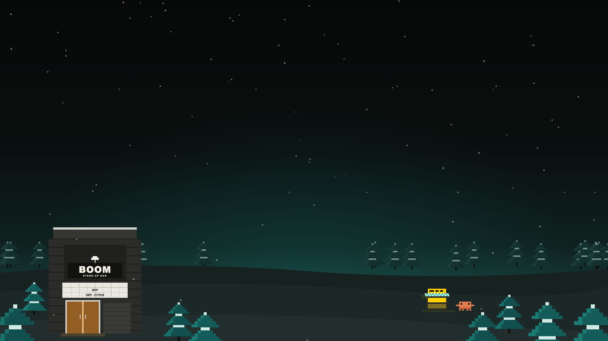

# FreeTicket theme for Claude

A dark theme for the Claude desktop and mobile apps, in FreeTicket's colors, with an animated pixel-art backdrop.



## What you get

- **Cartel ink surfaces** with cream text, the brand **yellow** as accent and **teal** and **purple** for code.
- **A quiet night sky** that fades to a teal glow on the horizon, with a few dim stars and slow snow.
- **Detail only at the foot and edges**, so nothing busy sits behind the words:
  - the **Boom Stand-Up Bar** front, with its lit sign, the letter board and warm light in the doors
  - a **FreeTicket booth** with a little critter selling tickets
  - snowy hills and pixel pines
- **Frosted glass panels**: the prompt box and panels blur the scene behind them.
- Motion stops when the system asks for reduced motion.

Dark mode only. Terminals and editors draw no themes, so there it does nothing.

## Install

At the prompt of a Claude Code terminal session:

```
/plugin install freeticket-theme --marketplace AppFreeticket/freeticket-claude-theme
```

Answer `y` to add the marketplace, then pick a scope.

From a shell:

```bash
claude plugin install freeticket-theme --marketplace AppFreeticket/freeticket-claude-theme
```

In the desktop app, where `/plugin` does not run: click **+** next to the prompt box, then **Plugins**, **Add marketplace** with `AppFreeticket/freeticket-claude-theme`, then **Add plugin**.

Start a new session to see it. `/freeticket-theme` re-applies the look and says whether the app draws it.

## Update

```bash
claude plugin marketplace update freeticket-claude-theme && claude plugin update freeticket-theme
```

## Remove

```bash
claude plugin uninstall freeticket-theme
```

## How it works

One hooks module, [`hooks/register.tsx`](hooks/register.tsx). At `session.start` it sets the palette (built with `make-colors.js`) and a backdrop scene, and a `ui.render` hook on `Backdrop` draws the scene as one inline SVG, animated with CSS. No scripts, no network.

## License

MIT
